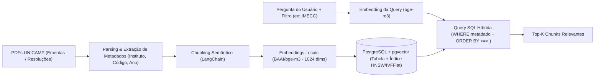

# Desafio 01: Motor de Busca Semântica (RAG com PostgreSQL + pgvector)

Sistema de recuperação de resoluções acadêmicas e ementas de disciplinas da UNICAMP, combinando filtragem relacional exata (`WHERE instituto = 'IMECC'`) com busca vetorial por similaridade de cosseno (`<=>`) no PostgreSQL.

---

## Arquitetura do Fluxo de Dados



---

## Estrutura de Diretórios do Projeto

```text
01-rag-postgresql-unicamp/
├── README.md                 # Visão geral e arquitetura do Desafio 01
├── TODO.md                   # Guia de estudo e checklist passo a passo
├── requirements.txt          # Dependências Python do projeto
├── data/
│   ├── raw/                  # PDFs brutos (cadernos de horários/ementas DAC, resoluções CONSU/CCG)
│   └── processed/            # Textos limpos e metadados extraídos em JSON/Parquet (opcional)
├── docker/
│   └── initdb/               # Scripts SQL executados na subida do banco (CREATE EXTENSION vector, tabelas)
├── src/
│   ├── ingestion/            # Leitura de PDFs, limpeza de texto e extração de metadados (instituto, código)
│   ├── embeddings/           # Configuração e inferência local do modelo BAAI/bge-m3
│   ├── database/             # Conexão PostgreSQL, DDL de tabelas e criação de índices HNSW / IVFFlat
│   └── retrieval/            # Consultas SQL híbridas (filtro relacional + busca vetorial)
└── tests/                    # Testes de sanidade da ingestão e qualidade do retrieval
```

## Como usar este repositório de estudo
Siga o roteiro detalhado em [TODO.md](./TODO.md), avançando uma fase por vez.
