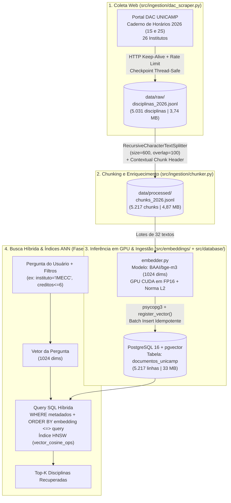

# Motor de Busca Semântica Híbrido — Catálogo de Disciplinas UNICAMP (RAG com PostgreSQL + pgvector)

Sistema completo de **Engenharia de Dados e Recuperação Semântica Híbrida (RAG)** construído sobre o catálogo real de disciplinas de Graduação da **UNICAMP (1º e 2º Semestres de 2026)**.

O projeto resolve uma limitação clássica de sistemas RAG tradicionais: em vez de utilizar um banco vetorial isolado incapaz de realizar filtros relacionais estritos com eficiência, implementamos uma arquitetura **Relacional + Vetorial unificada no PostgreSQL 16 com `pgvector`**, combinando:
- **Filtros estruturados exatos (`B-Tree`):** `WHERE instituto = 'IMECC' AND semestre = '1S' AND creditos <= 6`
- **Busca semântica densa (`pgvector` `<=>`):** Ordenação por distância de cosseno em vetores de **1.024 dimensões** gerados localmente em GPU NVIDIA pelo modelo multilíngue **`BAAI/bge-m3`**.

---

## 1. Arquitetura do Pipeline de Engenharia



---

## 2. Métricas Reais do Projeto (Dataset UNICAMP 2026)

| Etapa do Pipeline | Métrica / Resultado Obtido | Detalhes Técnicos |
| :--- | :--- | :--- |
| **Institutos Cobertos** | **26 Institutos (100% da UNICAMP)** | `IMECC`, `IC`, `FEEC`, `IFGW`, `CEL`, `FCM`, `FEM`, `FEQ`, `IA`, `FT`, `FCA`, `IFCH`, `IB`, `FECFAU`, `IEL`, `IQ`, `FE`, `FEA`, `FEAGRI`, `FCF`, `FEF`, `FENF`, `FOP`, `IE`, `IG`, `REIT` |
| **Disciplinas Coletadas (`raw`)** | **5.031 disciplinas** | Catálogo oficial de Graduação `1S/2026` e `2S/2026` (`0` disciplinas sem ementa) |
| **Chunks Gerados (`processed`)** | **5.217 chunks** | `4.869` disciplinas em chunk único + `162` disciplinas longas divididas em múltiplos chunks (`>600` caracteres, `overlap=100`) |
| **Modelo de Embedding** | **`BAAI/bge-m3` (`1024` dimensões)** | Multilíngue (Português nativo), vetores normalizados (`Norma L2 = 1.0`) |
| **Performance de Vetorização** | **~55 chunks/segundo (91,3s total)** | Executado localmente em GPU NVIDIA (`CUDA 12.6`) utilizando precisão mista `FP16 (torch.float16)` (~1,1 GB de VRAM) |
| **Armazenamento no PostgreSQL** | **5.217 linhas (`33 MB` em disco)** | Container Docker `pgvector/pgvector:pg16` com volume persistente |
| **Aceleração com Índice HNSW** | **`0,582 ms` (~64,5x mais rápido)** | Comparado ao `Sequential Scan` (`37,541 ms`), mantendo `100,0%` de `Recall@10` |

---

## 3. Estrutura de Diretórios

```text
01-rag-postgresql-unicamp/
├── README.md                        # Documentação técnica completa do projeto
├── TODO.md                          # Roteiro guiado de estudo passo a passo (6 fases)
├── requirements.txt                 # Dependências Python do projeto
├── docker-compose.yml               # Orquestração do container PostgreSQL 16 + pgvector
├── .env.example                     # Modelo de variáveis de ambiente de conexão ao banco
├── data/
│   ├── raw/
│   │   └── disciplinas_2026.jsonl   # 5.031 disciplinas brutas extraídas do portal da DAC
│   └── processed/
│       └── chunks_2026.jsonl        # 5.217 chunks com cabeçalho contextual prontos para vetorização
├── docker/
│   └── initdb/
│       └── 01_schema.sql            # DDL da extensão vector, tabela híbrida e índices B-Tree
├── src/
│   ├── ingestion/
│   │   ├── dac_scraper.py           # Web Scraper paralelo (Keep-Alive, Rate Limit e Checkpoint)
│   │   └── chunker.py               # Divisor semântico recursivo e injeção de cabeçalho contextual
│   ├── embeddings/
│   │   └── embedder.py              # Inferência local do BAAI/bge-m3 com suporte a GPU (FP16)
│   ├── database/
│   │   ├── ingest.py                # Ingestão em lotes (batch insert) idempotente no PostgreSQL
│   │   └── benchmark_indexes.py     # Benchmark EXPLAIN ANALYZE: Seq Scan vs IVFFlat vs HNSW
│   └── retrieval/                   # (Em implementação na Fase 6: Busca Híbrida SQL + Vetorial)
└── tests/                           # Testes e validações
```

---

## 4. Modelagem do Banco de Dados Híbrido (`01_schema.sql`)

A tabela `documentos_unicamp` definida em [docker/initdb/01_schema.sql](./docker/initdb/01_schema.sql) foi desenhada para refletir a estrutura oficial do Caderno de Horários da DAC UNICAMP, separando atributos de filtragem exata em colunas relacionais indexadas por `B-Tree` e mantendo metadados complementares em `JSONB`:

```sql
CREATE EXTENSION IF NOT EXISTS vector;

CREATE TABLE IF NOT EXISTS documentos_unicamp (
    id SERIAL PRIMARY KEY,
    
    -- Metadados Relacionais da DAC / UNICAMP (usados em filtros WHERE exatos)
    tipo_documento VARCHAR(50) NOT NULL DEFAULT 'disciplina',
    ano INTEGER NOT NULL,                     -- Ex: 2026
    semestre VARCHAR(10),                     -- Ex: '1S', '2S'
    instituto VARCHAR(20) NOT NULL,           -- Ex: 'IMECC', 'IC', 'FEEC', 'IFGW', 'CEL'
    codigo_disciplina VARCHAR(20),            -- Sigla da disciplina, ex: 'MA111', 'MC102', 'F 128'
    titulo TEXT NOT NULL,                     -- Nome da disciplina, ex: 'Cálculo I'
    creditos INTEGER,                         -- Número de créditos, ex: 6 (permite WHERE creditos <= 4)
    pre_requisitos TEXT,                      -- Ex: 'MA111 MA141' ou 'Nenhum'
    
    -- Conteúdo Textual (Chunk enriquecido) e Metadados Extras
    chunk_index INTEGER NOT NULL DEFAULT 0,   -- Índice do fragmento (0, 1, ...)
    conteudo_chunk TEXT NOT NULL,             -- Cabeçalho Contextual + Ementa
    metadata_json JSONB DEFAULT '{}'::jsonb,  -- ano_catalogo, continencia, equivalencia, url_origem
    
    -- Coluna Vetorial (BAAI/bge-m3 = 1024 dimensões em ponto flutuante)
    embedding vector(1024) NOT NULL,
    
    criado_em TIMESTAMP WITH TIME ZONE DEFAULT CURRENT_TIMESTAMP
);
```

---

## 5. Detalhamento Técnico dos Módulos Construídos

### 5.1. Coleta Web Resiliente ([`src/ingestion/dac_scraper.py`](./src/ingestion/dac_scraper.py))
Realiza o *scraping* direto das páginas do Caderno de Horários da DAC (`https://www.dac.unicamp.br/portal/caderno-de-horarios/2026/{semestre}/S/G/{instituto}/{codigo}`):
- **Reutilização de Conexão TCP (`HTTP Keep-Alive`):** Utiliza `threading.local()` para que cada *worker* mantenha uma única sessão TCP/TLS persistente aberta, evitando o bloqueio por *SYN flood* no firewall da universidade.
- **Checkpoint Incremental em `.jsonl`:** Cada disciplina coletada é gravada imediatamente no disco protegida por `threading.Lock()`. Caso a execução seja interrompida, a próxima rodada lê as chaves existentes (`2026_1S_IMECC_MA111`) em memória e baixa apenas as disciplinas faltantes.
- **Tratamento de Siglas com Espaço (`%20`):** Decodifica siglas especiais de 5 caracteres como `F%20128` -> `F 128` (Física Geral I no `IFGW`).

### 5.2. Chunking Semântico e *Contextual Header* ([`src/ingestion/chunker.py`](./src/ingestion/chunker.py))
Transforma os registros brutos de `data/raw/disciplinas_2026.jsonl` em blocos prontos para RAG em `data/processed/chunks_2026.jsonl`:
- **Divisão Recursiva:** Aplica o `RecursiveCharacterTextSplitter` (`chunk_size=600`, `chunk_overlap=100`) priorizando quebras em parágrafos e frases completas.
- **Enriquecimento Contextual (*Contextual Chunk Header*):** Ementas acadêmicas isoladas frequentemente não repetem o código ou nome da disciplina no corpo do texto. Para garantir alta precisão tanto na busca semântica quanto na leitura pelo LLM, cada chunk recebe um cabeçalho estruturado antes da vetorização:
  ```text
  [Instituto: IMECC | Disciplina: MA446 - Grupos e Representações (Parte 1/2) | Período: 1S/2026 | Créditos: 8 | Pré-requisitos: MA425 MA553/ MA553 MA719 | MA425/ MA719 | MA719]
  Ementa: Grupos, subgrupos, classes laterais, teorema de Lagrange, homomorfismo, subgrupos normais...
  ```

### 5.3. Motor de Embeddings Local em GPU ([`src/embeddings/embedder.py`](./src/embeddings/embedder.py))
Encapsula o modelo **`BAAI/bge-m3`** via `SentenceTransformer`:
- **Otimização de VRAM (`FP16`):** Detecta automaticamente a presença de GPU NVIDIA (`torch.cuda.is_available()`) e carrega os pesos em `torch.float16`, reduzindo o uso de VRAM pela metade (~1,1 GB em vez de ~2,3 GB) e acelerando a inferência nos *Tensor Cores*.
- **Normalização L2 (`normalize_embeddings=True`):** Garante que todos os vetores gerados sejam unitários (`norma = 1.0`), condição ideal para buscas por distância de cosseno (`<=>`).

### 5.4. Ingestão Vetorial em Lote ([`src/database/ingest.py`](./src/database/ingest.py))
Conecta o pipeline de embeddings ao PostgreSQL:
- Registra o adaptador nativo do `pgvector` no `psycopg3` (`register_vector(conn)`).
- Verifica no banco quais pares `(chave_origem, chunk_index)` já foram inseridos anteriormente, garantindo **idempotência** (pode ser reexecutado sem duplicar linhas).
- Processa a fila em lotes (`batch_size=32`), combinando inferência em *batch* na GPU com `cur.executemany()` em transações SQL únicas.

### 5.5. Benchmark de Índices Vetoriais ANN ([`src/database/benchmark_indexes.py`](./src/database/benchmark_indexes.py))
Avalia na prática o planejador do PostgreSQL (`EXPLAIN (ANALYZE, BUFFERS)`) sobre os 5.217 vetores de 1024 dimensões, comparando a varredura exata (`Sequential Scan`) com os dois algoritmos de *Approximate Nearest Neighbor (ANN)* do `pgvector`:

```text
==================================================================================
RESUMO COMPARATIVO DE ENGENHARIA (5.217 VETORES DE 1024 DIMENSÕES)
==================================================================================
Estratégia                   | Build Time | Tamanho  | Busca (ms)   | Recall@10 
----------------------------------------------------------------------------------
1. Sem Índice (Seq Scan)     | 0.00s      | 0 MB     |   37.541 ms | 100.0%    
2. Índice IVFFlat (lists=100) | 0.76s      | 42 MB    |    0.922 ms | 100.0%    
3. Índice HNSW (m=16, ef=64) | 1.27s      | 41 MB    |    0.582 ms | 100.0%    
----------------------------------------------------------------------------------
Aceleração Real do HNSW sobre o Sequential Scan: ~64.5x mais rápido na busca!
==================================================================================
```

---

## 6. Validação Prática no PostgreSQL (Similaridade de Cosseno Real)

Abaixo está o resultado real de uma consulta executada sobre os **5.217 vetores** gravados no PostgreSQL, comparando o vetor da disciplina **`MA111 (Cálculo I - IMECC)`** com outras disciplinas da universidade através da fórmula `1 - (a.embedding <=> b.embedding)`:

```text
 disc_base | instituto | comparada |                  titulo                  | similaridade_cosseno 
-----------+-----------+-----------+------------------------------------------+----------------------
 MA111     | IMECC     | MA111     | Cálculo I                                |               1.0000
 MA111     | IMECC     | MA211     | Cálculo II                               |               0.8157
 MA111     | IMECC     | MA141     | Geometria Analítica e Vetores            |               0.7531
 MA111     | IC        | MC102     | Algoritmos e Programação de Computadores |               0.7225
 MA111     | IFGW      | F 128     | Física Geral I                           |               0.6597
 MA111     | CEL       | LA091     | Língua Inglesa I                         |               0.6433
```

---

## 7. Como Executar o Projeto do Zero

### Passo 1: Preparar o Ambiente Virtual e Dependências
No terminal PowerShell (dentro da pasta `01-rag-postgresql-unicamp`):

```powershell
python -m venv .venv
.\.venv\Scripts\Activate.ps1
pip install -r requirements.txt

# Opcional (Recomendado se possuir GPU NVIDIA): Instalar PyTorch com suporte a CUDA
pip install torch --index-url https://download.pytorch.org/whl/cu124 --force-reinstall --no-deps
```

### Passo 2: Subir o Banco de Dados (`PostgreSQL 16 + pgvector`)
Certifique-se de que o Docker Desktop esteja aberto e execute:

```powershell
cp .env.example .env
docker compose up -d
```

### Passo 3: Coleta e Processamento de Chunks
*(Nota: Os arquivos `data/raw/disciplinas_2026.jsonl` e `data/processed/chunks_2026.jsonl` já estão versionados no repositório. Você só precisa rodar o scraper caso deseje atualizar os dados a partir do portal da DAC).*

```powershell
# Coletar apenas um instituto específico (ex: IMECC)
python src/ingestion/dac_scraper.py --institutos IMECC --workers 2 --delay 0.6

# Ou coletar todos os 26 institutos da UNICAMP
python src/ingestion/dac_scraper.py --todos --workers 2 --delay 0.6

# Gerar os chunks enriquecidos em data/processed/chunks_2026.jsonl
python src/ingestion/chunker.py
```

### Passo 4: Gerar Embeddings e Ingerir no PostgreSQL
```powershell
# Testar isoladamente o modelo BAAI/bge-m3
python src/embeddings/embedder.py

# Ingerir todos os 5.217 chunks e vetores de 1024 dimensões no PostgreSQL
python src/database/ingest.py
```

---

## 8. Roteiro de Estudo Guiado
Para acompanhar a evolução teórica e prática de cada etapa (incluindo os próximos passos de **Fase 5: Benchmark de Índices `HNSW` vs `Sequential Scan`** e **Fase 6: Motor de Busca Híbrida RAG**), consulte o checklist em [TODO.md](./TODO.md).
