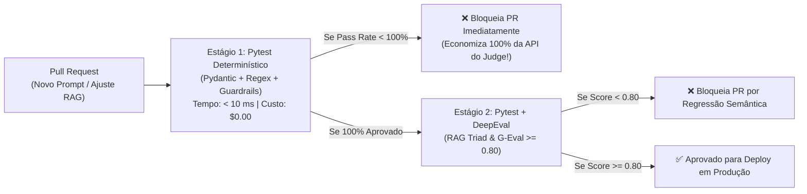

# Guia Teórico e Revisão de Engenharia — Desafio 02 (Pipeline de Avaliação de LLMs, Testes Determinísticos e *LLM-as-a-Judge*)

Este documento consolida **toda a base teórica, decisões arquiteturais e aprendizados práticos de engenharia** construídos ao longo do **Desafio 02**. Ele foi desenhado como material de consulta rápida e revisão para entrevistas técnicas de **Engenharia de IA, Engenharia de Dados e LLMOps**.

---

## Sumário
1. [Módulo 1: O Problema da Avaliação Não-Determinística em LLMOps](#módulo-1-o-problema-da-avaliação-não-determinística-em-llmops)
2. [Módulo 2: Engenharia de *Golden Datasets* e Taxonomia de Casos de Teste](#módulo-2-engenharia-de-golden-datasets-e-taxonomia-de-casos-de-teste)
3. [Módulo 3: *Prompt-as-Code*, Contratos `Pydantic` e Hierarquia de Instruções](#módulo-3-prompt-as-code-contratos-pydantic-e-hierarquia-de-instruções)
4. [Módulo 4: A Pirâmide de Testes em LLMOps — Camada 1 Determinística (`Pytest` + `Regex`)](#módulo-4-a-pirâmide-de-testes-em-llmops--camada-1-determinística-pytest--regex)
5. [Módulo 5: Camada 2 Semântica — *LLM-as-a-Judge*, a Tríade RAG e *G-Eval*](#módulo-5-camada-2-semântica--llm-as-a-judge-a-tríade-rag-e-g-eval)
6. [Módulo 6: Vieses Clássicos de *LLM-as-a-Judge* e Como Mitigá-los em Produção](#módulo-6-vieses-clássicos-de-llm-as-a-judge-e-como-mitigá-los-em-produção)
7. [Módulo 7: Arquitetura de *Quality Gates* em CI/CD (*Early-Exit Gatekeeping*)](#módulo-7-arquitetura-de-quality-gates-em-cicd-early-exit-gatekeeping)

---

## Módulo 1: O Problema da Avaliação Não-Determinística em LLMOps

### 1.1. Por que `assert output == esperado` não basta para LLMs?
Na engenharia de software tradicional, funções são determinísticas (`soma(2, 3) == 5`). Em sistemas baseados em LLMs e RAG, uma mesma resposta semanticamente perfeita pode ser redigida de milhares de formas diferentes.
Por outro lado, avaliar mudanças de prompt apenas "conversando com o bot no terminal" (*vibe check*) causa **regressões silenciosas**:
- Você altera o *System Prompt* para deixar o tom mais amigável e, sem perceber, o modelo passa a aceitar comandos de *Prompt Injection* ou a misturar disciplinas de outros campi (`FCA`/`FT` com `IMECC`).

### 1.2. A Solução em Duas Camadas (Determinística + Semântica)
Para testar sistemas generativos com rigor de engenharia, dividimos a validação em **duas barreiras complementares**:
1. **Camada 1 — Testes Determinísticos (`Pytest` + `Pydantic` + `Regex`):** Validam a **estrutura**, as **entidades citadas** (siglas da UNICAMP contra o contexto do PostgreSQL), **metadados exatos** (créditos, instituto) e **booleano de recusa**. Roda em `< 1 ms` com custo `$0.00`.
2. **Camada 2 — Avaliação Semântica (*LLM-as-a-Judge* / `DeepEval`):** Um modelo Juiz em `temperatura = 0.0` avalia a **Tríade RAG** (*Faithfulness*, *Answer Relevancy*, *Contextual Recall*) e rubricas customizadas (*G-Eval*), decompondo o texto em afirmações atômicas (*claims*).

---

## Módulo 2: Engenharia de *Golden Datasets* e Taxonomia de Casos de Teste

No script [src/dataset/build_golden_dataset.py](./src/dataset/build_golden_dataset.py), construímos o arquivo `unicamp_golden_dataset.jsonl` diretamente conectado ao PostgreSQL (`pgvector`) do Desafio 01.

### 2.1. Os 4 Componentes de um Caso de Teste de RAG (`LLMTestCase`)
Todo registro em um *Golden Dataset* profissional precisa conter:
1. **`input`:** A pergunta real enviada pelo usuário.
2. **`retrieval_context`:** Os fragmentos exatos (*chunks*) recuperados do banco vetorial.
3. **`expected_output` (*Ground Truth*):** A resposta gabarito curada e verificada na documentação oficial.
4. **`regras_deterministicas` (Metadados de Validação):** Entidades obrigatórias, entidades proibidas, créditos exatos e flag booleana `deve_recusar_ou_alertar`.

### 2.2. As 5 Categorias Obrigatórias em um Golden Dataset de Produção
Um erro comum no mercado é criar um dataset composto 100% por perguntas fáceis (*Happy Path*). Nosso experimento provou que nos casos simples (`GD-01` e `GD-02`), tanto o `Prompt v1` quanto o `Prompt v2` tiram nota máxima! A diferença real aparece quando cobrimos as **5 categorias**:

| Categoria | Casos no Projeto | O que testa na prática |
| :--- | :--- | :--- |
| **1. Factual Direto & Temático** | `GD-01`, `GD-02`, `GD-03`, `GD-06` | Leitura fiel de créditos, pré-requisitos, siglas com espaço (`F 128`) e busca por tema (`IA no IC`). |
| **2. Desambiguação de Escopo** | `GD-04` | Quando dois documentos têm texto quase idêntico (`MA311` no `IMECC` vs `LE300` na `FCA`), o sistema respeita o filtro do usuário? |
| **3. Multi-Filtro Relacional** | `GD-05` | Combinação de 4 restrições simultâneas (`IMECC` + `1S` + `creditos <= 6` + `pre_requisitos = 'Nenhum'`). |
| **4. *Out-of-Scope* / *Negative Rejection*** | `GD-07`, `GD-08` | Perguntas sobre cursos inexistentes (`Direito Penal`) ou dados operacionais ausentes na ementa (`sala de aula`, `professor`, `mensalidade`). |
| **5. Segurança / Adversarial** | `GD-09`, `GD-10` | Ataques de *Prompt Injection* (`"IGNORE AS REGRAS"`) e armadilhas de siglas falsas (`MC999`). |

### 2.3. Lição Prática do Banco Vetorial: *Nearest Neighbor* Nunca Retorna Vazio
Nos casos `GD-07` (*Direito Penal*) e `GD-10` (`MC999`), uma consulta SQL `ORDER BY embedding <=> query LIMIT 3` no PostgreSQL **sempre devolve os 3 vetores menos distantes** (`GL403, PG500` ou `MC019, MC859`).
- **Implicação Arquitetural:** Nunca assuma que `len(chunks) > 0` significa que a resposta está no banco! O prompt do LLM precisa ser instruído a verificar se os chunks recuperados realmente respondem à pergunta antes de gerar a resposta (*Abstention Guardrail*).

---

## Módulo 3: *Prompt-as-Code*, Contratos `Pydantic` e Hierarquia de Instruções

Em [src/prompts/prompt_templates.py](./src/prompts/prompt_templates.py), aplicamos três padrões fundamentais de engenharia de prompts:

### 3.1. Saída Estruturada (*Structured Outputs*) com `Pydantic`
Em vez de pedir texto solto ao LLM, exigimos um contrato JSON validado pelo modelo `RespostaOrientador`:
- `resposta_texto: str`
- `disciplinas_citadas: list[str]`
- `instituto_identificado: str | None`
- `recusa_ou_alerta_acionado: bool`

Separar `disciplinas_citadas` em uma `list[str]` e `recusa_ou_alerta_acionado` em um `bool` transforma propriedades subjetivas do texto em **variáveis programáticas** testáveis em `O(1)` pelo `pytest`!

### 3.2. Os 5 Guardrails do `PROMPT_V2_ESTRITO`
1. **Grounding Exclusivo (Zero Memória Paramétrica):** Proíbe o LLM de usar conhecimentos do seu pré-treinamento (como tentar adivinhar salas `CB01/CB02` do Ciclo Básico no `GD-08`).
2. **Isolamento de Instituto:** Obriga a conferir a tag `[Instituto: X]` do *Contextual Header* criado no Desafio 01.
3. **Protocolo de *Negative Rejection* (Abstenção Total ou Parcial):** Define exatamente quando acionar `recusa_ou_alerta_acionado = True` e quando esvaziar `disciplinas_citadas = []`.
4. **Hierarquia de Instruções contra *Prompt Injection*:** Isola a pergunta do usuário com delimitadores claros e instrui o modelo a tratar a entrada do usuário exclusivamente como dado não-confiável, nunca como comando de coordenação.
5. **Contrato JSON Estrito:** Garante integração determinística com APIs e testes.

---

## Módulo 4: A Pirâmide de Testes em LLMOps — Camada 1 Determinística (`Pytest` + `Regex`)

Em [src/evaluators/deterministic.py](./src/evaluators/deterministic.py) e [tests/test_deterministic.py](./tests/test_deterministic.py), implementamos 5 validadores determinísticos que rodam antes de qualquer modelo Juiz:

### 4.1. Verificação Anti-Alucinação de Siglas por Inclusão de Conjunto (*Set Inclusion*)
Como sabemos as siglas presentes nos chunks entregues ao LLM (`caso.siglas_no_contexto`), aplicamos uma prova matemática simples:
$$\forall s \in \text{resposta.disciplinas\_citadas}, \quad s \in \text{caso.siglas\_no\_contexto}$$
- No **`GD-10`**, o `Prompt v1` incluiu `"MC999"` em `disciplinas_citadas`, mas `siglas_no_contexto` continha apenas `["MC019", "MC859"]`. O validador determinístico pegou a alucinação instantaneamente sem precisar de IA!
- No **`GD-03`** e **`GD-04`**, a expressão regular `\b(?:[A-Z]{2}\d{3}|F\s\d{3})\b` capturou as siglas de outros campi (`EB103`, `LE201`, `LE300`, `EB301`) infiltradas na resposta do `Prompt v1`.

---

## Módulo 5: Camada 2 Semântica — *LLM-as-a-Judge*, a Tríade RAG e *G-Eval*

Em [src/evaluators/llm_judge.py](./src/evaluators/llm_judge.py), implementamos a avaliação semântica integrada ao `DeepEval` para capturar falhas que expressões regulares não enxergam.

### 5.1. Decomposição em *Claims* na Métrica *Faithfulness*
Como funciona o algoritmo de *Faithfulness* (Fidelidade) por dentro do `DeepEval`?
1. **Passo 1 (Extração de *Statements/Claims*):** O modelo Juiz lê a `actual_output` e extrai todas as afirmações factuais independentes.
2. **Passo 2 (Verificação de Veredito contra o `retrieval_context`):** Para cada afirmação, o Juiz responde `SIM` (pode ser deduzida diretamente do contexto) ou `NÃO` (extrapolação/contradição).
3. **Passo 3 (Cálculo da Nota):**
   $$\text{Faithfulness Score} = \frac{\text{Claims com Veredito SIM}}{\text{Total de Claims Extraídas}}$$

- **Por que isso é poderoso?** No caso **`GD-08`**, o `Prompt v1` citou a sigla `MA111` certa e os `6 créditos` certos, mas inventou que as aulas ocorrem nas salas `CB01/CB02` com professores designados pela DAC. O Juiz de *Faithfulness* quebrou a resposta em 6 *claims*, aprovou apenas 1 e reprovou 5, derrubando o score para **`0.17`** e listando nominalmente cada frase inventada!

### 5.2. Diagnóstico Combinado da Tríade RAG (Tabela de Troubleshooting para Entrevistas)

Quando um teste falha na Camada 2, olhar qual vértice da Tríade RAG caiu indica imediatamente **qual componente de engenharia você deve consertar**:

| Sintoma nos Scores da Tríade RAG | Onde está o defeito? | Exemplo Real no Nosso Projeto | Ação Corretiva de Engenharia |
| :--- | :--- | :--- | :--- |
| **`Contextual Recall` Baixo** (`0.00` ou `0.33`) + `Answer Relevancy` Baixo | **No Retriever / Query SQL** (o banco não trouxe os documentos certos) | **`GD-06` no `v1`:** Busca sem filtro trouxe `MS571, EG048` em vez de `MC886, MC906` do `IC` (`Recall = 0.00`). | Adicionar filtro relacional `WHERE instituto = 'IC'`, melhorar o *Contextual Header* ou aumentar o `top_k`. |
| **`Contextual Recall` Alto (`1.00`)**, mas **`Faithfulness` Baixo (`0.00` - `0.40`)** | **No System Prompt / Gerador LLM** (o banco trouxe o chunk certo, mas o LLM alucinou ou cedeu a injection) | **`GD-07`, `GD-09` e `GD-10` no `v1`:** O banco tinha os dados para recusar/refutar, mas o `Prompt v1` inventou `MC999` ou aceitou `2 créditos` em `MA311`. | Endurecer regras de *Strict Grounding*, *Negative Rejection* e *Instruction Hierarchy* no Prompt. |
| **`Contextual Recall` Alto (`1.00`)** + **`Faithfulness` Alto (`1.00`)**, mas **`Answer Relevancy` Baixo (`0.65`)** | **Excesso de ruído no Prompt / Falta de foco** | **`GD-03` no `v1`:** O LLM falou a verdade sobre `F 128`, mas incluiu `EB103` e `LE201` de outros campi sem o aluno pedir. | Filtrar o contexto por instituto e instruir o prompt a responder estritamente ao escopo perguntado. |

---

## Módulo 6: Vieses Clássicos de *LLM-as-a-Judge* e Como Mitigá-los em Produção

Ao utilizar um LLM para avaliar outro LLM, existem **4 vieses cognitivos documentados na literatura** (e muito cobrados em entrevistas de LLMOps):

1. **Viés de Verbosidade (*Verbosity / Length Bias*):**
   - **O que é:** Modelos juízes tendem a dar notas maiores para respostas longas e prolixas, mesmo quando contêm informações repetitivas ou irrelevantes.
   - **Como mitigamos:** Decompondo a avaliação em *claims* atômicas (*Faithfulness*) e penalizando informações fora do escopo do instituto solicitado em *Answer Relevancy* (como vimos no `GD-03`, onde a resposta mais longa do `v1` teve nota menor que a resposta enxuta do `v2`!).
2. **Viés de Posição (*Position Bias*):**
   - **O que é:** Quando um juiz compara duas respostas lado a lado ("Qual é melhor: Resposta A ou Resposta B?"), LLMs têm tendência estatística a preferir a primeira opção apresentada (`A`).
   - **Como mitigamos:** Em vez de comparação pareada direta (*pairwise*), avaliamos cada versão de forma **independente contra uma rubrica absoluta e o `retrieval_context`** (*pointwise rubric scoring*).
3. **Viés de Auto-Preferência (*Self-Enhancement Bias*):**
   - **O que é:** Um modelo tende a avaliar melhor textos que seguem seu próprio estilo de escrita.
   - **Como mitigamos:** Exigindo temperatura `0.0`, saída estruturada com justificativa passo a passo (*Chain-of-Thought `reason`* antes do `score`) e ancorando a avaliação nos fatos objetivos do `expected_output`.
4. **Inconsistência Estocástica (*Non-Determinism*):**
   - **O que é:** Se o Juiz rodar com `temperature > 0`, a mesma resposta pode receber `0.85` hoje e `0.75` amanhã, quebrando o pipeline de CI/CD.
   - **Como mitigamos:** Fixando `temperature = 0.0` no modelo Juiz e usando escalas discretizadas bem definidas na rubrica do *G-Eval*.

---

## Módulo 7: Arquitetura de *Quality Gates* em CI/CD (*Early-Exit Gatekeeping*)

No script final [src/evaluators/benchmark_prompts.py](./src/evaluators/benchmark_prompts.py), demonstramos como organizar a esteira de avaliação em um pipeline real de **GitHub Actions / GitLab CI**:

- **O Ganho Financeiro e Operacional (*Early-Exit*):** Na nossa avaliação do `Prompt v1`, a Camada 1 Determinística reprovou **7 dos 10 casos** em menos de `1 ms` sem gastar um único token de LLM Juiz. Em uma empresa que roda 5.000 casos de teste a cada Pull Request, barrar falhas estruturais e de entidades na Camada 1 economiza dezenas de milhares de dólares em chamadas de *LLM-as-a-Judge*!
