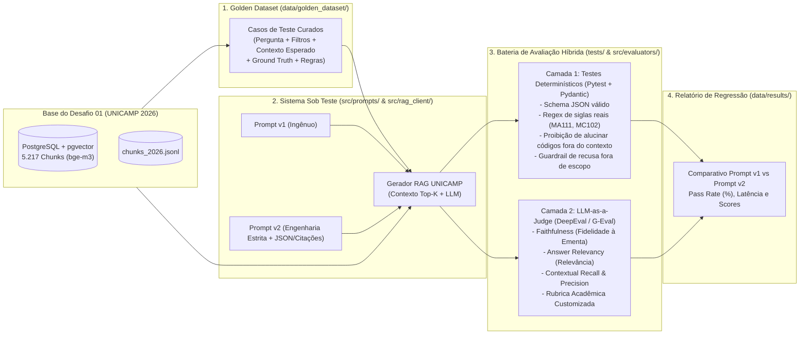

# Desafio 02: Pipeline de Avaliação de LLMs e RAG (Testes Determinísticos & *LLM-as-a-Judge*)

Pipeline de **Engenharia de Qualidade, Testes Determinísticos de Prompt e Avaliação Semântica (*LLM-as-a-Judge*)** construído sobre a base de dados e o motor de busca híbrida da **UNICAMP (Desafio 01)**.

O projeto resolve um dos maiores gargalos de **LLMOps em Produção**: como garantir que alterações em *System Prompts*, parâmetros de *Retrieval* (`Top-K`, filtros SQL) ou trocas de modelos de linguagem não introduzam **alucinações**, quebras de contrato JSON ou perda de precisão nas respostas acadêmicas antes do deploy.

---

## Arquitetura do Pipeline de Avaliação



---

## Estrutura de Diretórios do Projeto

```text
02-llm-eval-pipeline/
├── README.md                        # Visão geral e arquitetura do Desafio 02
├── TODO.md                          # Roteiro guiado de estudo passo a passo (6 fases)
├── requirements.txt                 # Dependências Python do projeto (Pytest, DeepEval, Pydantic, etc.)
├── .env.example                     # Modelo de variáveis de ambiente (Banco Desafio 01 + API Keys LLM)
├── data/
│   ├── golden_dataset/              # Dataset Padrão-Ouro (perguntas, ground truth e contextos UNICAMP)
│   └── results/                     # Relatórios JSON/Markdown de regressão (Prompt v1 vs Prompt v2)
├── src/
│   ├── dataset/                     # Construtor e validador do Golden Dataset a partir do Desafio 01
│   ├── rag_client/                  # Integração com a busca híbrida do Desafio 01 e chamada ao LLM
│   ├── prompts/                     # Versionamento de Prompts (v1 ingênuo vs v2 estruturado/restritivo)
│   └── evaluators/                  # Métricas determinísticas e juízes semânticos (LLM-as-a-Judge)
└── tests/                           # Suíte Pytest automatizada (Determinísticos + DeepEval)
```

---

## Como usar este repositório de estudo
Siga o roteiro detalhado em [TODO.md](./TODO.md), avançando uma fase por vez.
